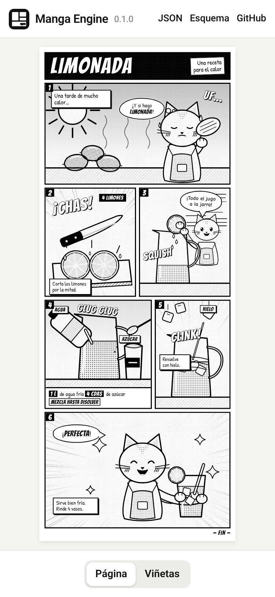

# 🗯️ manga-engine

> Motor open source de páginas manga en blanco y negro: escribes un JSON con viñetas y bocadillos, pones las imágenes y sale la página en PNG, ePub y CBZ lista para tu e-reader.

**[▶ Abrir la demo](https://juliangdeveloper.github.io/manga-engine/)**



## Qué hace
- Maqueta una página en una cuadrícula de columnas (12 por defecto) con filas en píxeles: viñetas con imagen, trama, número, globos de diálogo y pensamiento, narraciones, rótulos, onomatopeyas y cajas de texto bajo la imagen.
- Todo el texto vive en el JSON y nunca dentro de las imágenes, así que cambiar un diálogo es editar una línea.
- Cualquier modelo puede escribir el JSON siguiendo el [esquema](schema/manga.schema.json). Tú pones las imágenes y el motor hace el resto.
- Exporta para e-reader en grises con JPEG baseline: un ePub con una viñeta por página (las anchas se giran si así se leen más grandes), un ePub con la página completa cortada en pantallas por los canales entre viñetas, y CBZ.

## Instalar
Requisitos:
- Python 3.8 o superior con Pillow.
- Google Chrome o Chromium, que renderiza en modo headless.
- Las fuentes Bangers, Patrick Hand y Comic Neue. Se cargan de Google Fonts; para trabajar sin conexión, instálalas en el sistema.
- Node no hace falta.

```bash
git clone https://github.com/juliangdeveloper/manga-engine.git
cd manga-engine
python3 -m pip install --user Pillow
ln -s "$PWD/bin/manga" ~/.local/bin/manga
```

- En Debian o Ubuntu: `sudo apt install chromium python3-pil`.
- En macOS: `brew install --cask google-chrome`.
- Si Chrome está en otra ruta, indícala con `MANGA_CHROME=/ruta/al/chrome`.

## Uso
```bash
manga build receta.json --png --epub --strip --cbz
manga build receta.json --epub --profile kindle
manga build receta.json --strip --size 600x800 --fs 1.2
manga validate receta.json
manga profiles
```

| Opción | Qué hace |
|---|---|
| `--png` | Página completa en PNG. Es lo que sale si no pides otro formato. |
| `--epub` | ePub con una viñeta por página. |
| `--strip` | ePub con la página completa cortada en pantallas. |
| `--cbz` | CBZ con las mismas páginas: las de `--strip` si lo pides y, si no, una viñeta por página. |
| `--profile` | Perfil de e-reader: `x4` (por defecto), `kindle` o `kobo`. |
| `--size AxB` | Tamaño de pantalla propio en píxeles, dentro del máximo del perfil. |
| `--fs N` | Escala del texto en el modo una viñeta por página. |
| `--out DIR` | Carpeta de salida. Por defecto es la del JSON. |

- Antes de renderizar, `build` valida el JSON y lista cada error con su ruta, por ejemplo `panels[0].bubbles[0].tail: debe ser uno de "up", "down"…`. También avisa si una viñeta se sale de la cuadrícula o si falta una imagen.
- Archivos de salida: `receta.png`, `receta-x4.epub`, `receta-strip-x4.epub`, `receta-x4.cbz` y `receta-strip-x4.cbz`. Con `--size` la etiqueta es el tamaño, por ejemplo `receta-600x800.epub`.

## Perfiles
| Perfil | Pantalla | Notas |
|---|---|---|
| `x4` | 480×800 | Xteink X4 Pro. JPEG baseline en grises, nunca mayor de 2048×1536. Con firmware CrossPoint, activa las imágenes y copia el `.epub` a la microSD. |
| `kindle` | 1236×1648 | Kindle Paperwhite (11.ª gen.). Envía el ePub con Send to Kindle. |
| `kobo` | 1072×1448 | Kobo Clara BW y Clara 2E. Lee el ePub y el CBZ directamente. |

## El JSON
Empieza copiando [`example/limonada.json`](example/limonada.json). Las rutas de las imágenes son relativas al JSON, y `"$schema"` activa el autocompletado en el editor.

```json
{
  "$schema": "https://juliangdeveloper.github.io/manga-engine/schema/manga.schema.json",
  "columns": 12,
  "rows": [560, 600],
  "title": { "text": "LIMONADA", "sub": "Una receta\npara el calor" },
  "panels": [
    { "img": "img/p1.svg", "col": [1, 12], "row": [1],
      "bubbles": [{ "type": "thought", "text": "¿Y si hago\n<b>LIMONADA</b>?", "x": 40, "y": 14, "w": 250, "tail": "right" }] },
    { "img": "img/p2.svg", "col": [1, 6], "row": [2], "box": "<b>4</b> limones" }
  ]
}
```

- **Página**: `width` (1080), `padding`, `gap`, `columns`, `rows`, `title`, `footer`, `meta` (`title`, `lang`, `creator`), `cover`, `ereader` (giro, margen, gamma, enfoque y calidad) y `strip` (cómo se corta).
- **Viñeta**: `img`, `col: [inicio, columnas]`, `row: [inicio, filas]`, `focus` (object-position), `scale`, `bw`, `tone`, `border`, `number`, `box` (HTML corto), `boxSize`, `ereader` (`fs`, `boxFs`, `rotate` y cambios por bocadillo) y `bubbles`.
- **Bocadillo**: `type` (`speech`, `thought`, `caption`, `label` o `sfx`), `text` (`\n` hace salto de línea y `<b>` resalta), `x` e `y` en % de la viñeta, `w` en px, `size`, `rot`, `tail` (`up`, `down`, `left`, `right` o `none`), `tailAt` en %, `shape: "box"` y `dark`.
- Para pedírselo a un modelo: «Escribe un JSON que cumpla https://juliangdeveloper.github.io/manga-engine/schema/manga.schema.json para contar [contenido] en 4 a 6 viñetas. Pon todo el texto en bubbles o box y usa img/p1.jpg, img/p2.jpg…». Después genera o dibuja cada imagen sin texto y corre `manga validate`.

## La demo
- Renderiza `example/limonada.json` en el navegador con el mismo `engine/render.js` que usa la CLI.
- **Página** muestra la página entera. **Viñetas** la lee viñeta por viñeta con ‹ ›, deslizando o con las flechas del teclado.
- En `localStorage` guarda `manga-engine.stats` (viñetas vistas) y `meta.v1.manga-engine`.

## Licencia
[MIT](LICENSE)
